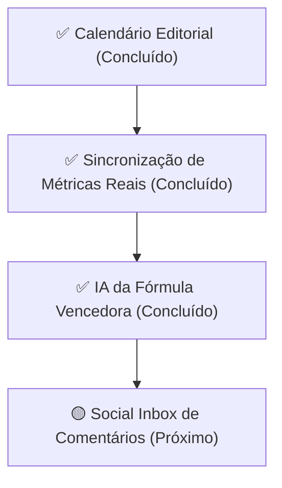

# 🗺️ Roadmap de Evolução & Matriz de Prioridades do Produto

Este documento consolida as principais oportunidades de evolução para transformar a ferramenta de publicação e gestão de conteúdo em uma solução completa e de alto valor estratégico para criadores.

---

## 📊 Matriz RICE & Status Atual das Iniciativas

| Nível | Funcionalidade | Impacto | Esforço | Status | Justificativa |
| :---: | :--- | :---: | :---: | :---: | :--- |
| **P0** | **1. Sincronização Real de Métricas (Backend Worker)** | 🔥 Máximo | 🟡 Médio | ✅ **CONCLUÍDO** | Worker assíncrono com suporte a YouTube, Instagram e TikTok, persistência de snapshots e endpoints integrados ao frontend. |
| **P1** | **2. Inteligência "Fórmula Vencedora" por IA** | 🔥 Máximo | 🟡 Médio | ✅ **CONCLUÍDO** | Diagnóstico real de ganchos (0-3s), detecção de padrões comprovados de audiência e gerador de 5 variações completas de roteiro com 1 clique. |
| **P2** | **3. Caixa de Entrada Unificada de Comentários (Social Inbox)** | 🟡 Médio | 🔴 Médio/Alto | ⏳ **A Fazer (Próximo)** | Responder comentários de YouTube, Instagram e TikTok a partir de uma única tela nos primeiros 60 minutos. |

---

## 🎯 Detalhamento do que Foi Feito e o que Falta

### ✅ 1. PRIORIDADE 0: Sincronização Real de Métricas no Backend (CONCLUÍDO)
* **Status:** Entregue e integrado com sucesso.
* **O que foi implementado:**
  * Worker periódico de sincronização de métricas (`sync_metrics_task_sync`) no `tasks.py` e `scheduler.py`.
  * Serviço [`MetricsCollectorService`](file:///c:/Users/aryar/.gemini/antigravity/scratch/Projetos%20Serios/Projetos%20Principais/Projeto%20-%20Publicar%20Conteudo/backend/app/services/metrics_collector.py) integrado com YouTube Data API v3, Meta Graph API (Instagram) e TikTok Query API.
  * Tabela [`post_metric_snapshots`](file:///c:/Users/aryar/.gemini/antigravity/scratch/Projetos%20Serios/Projetos%20Principais/Projeto%20-%20Publicar%20Conteudo/Arquivos/DATABASE_SCHEMA_LOG.md) para séries temporais e colunas de cache em `platform_publications`.
  * Endpoints `/api/analytics/summary`, `/api/analytics/sync` e `/api/analytics/posts/{id}/history`.
  * Botão "Atualizar Métricas" com feedback visual e atualização em tempo real no dashboard.

---

### ✅ 2. PRIORIDADE 1: Inteligência "Fórmula Vencedora" por IA (CONCLUÍDO)
* **Status:** Entregue e integrado com sucesso.
* **O que foi implementado:**
  * Serviço backend [`WinningFormulaService`](file:///c:/Users/aryar/.gemini/antigravity/scratch/Projetos%20Serios/Projetos%20Principais/Projeto%20-%20Publicar%20Conteudo/backend/app/services/winning_formula_service.py) com análise heurística e linguística dos ganchos (perguntas, gatilhos de curiosidade, brevidade).
  * Detecção da Fórmula Vencedora Geral do Canal via `GET /api/analytics/winning-formula`, exibindo o padrão comprovado de abertura e as 3 regras de ouro do canal.
  * Gerador de 5 variações de roteiro completas prontas para gravar via `POST /api/analytics/posts/{id}/generate-scripts`.
  * Subcomponente frontend [`ScriptVariationsList.tsx`](file:///c:/Users/aryar/.gemini/antigravity/scratch/Projetos%20Serios/Projetos%20Principais/Projeto%20-%20Publicar%20Conteudo/frontend/src/components/analytics/ScriptVariationsList.tsx) integrado no [`VideoIntelligenceDrawer.tsx`](file:///c:/Users/aryar/.gemini/antigravity/scratch/Projetos%20Serios/Projetos%20Principais/Projeto%20-%20Publicar%20Conteudo/frontend/src/components/analytics/VideoIntelligenceDrawer.tsx) com accordion, cópia de gancho e cópia de roteiro integral com toast.
  * Card de destaque da Fórmula Vencedora Comprovada no [`PerformanceOverviewCards.tsx`](file:///c:/Users/aryar/.gemini/antigravity/scratch/Projetos%20Serios/Projetos%20Principais/Projeto%20-%20Publicar%20Conteudo/frontend/src/components/analytics/PerformanceOverviewCards.tsx).

---

### 🟢 3. PRIORIDADE 2 (Próximo): Caixa de Entrada Unificada de Comentários (Social Inbox)
* **Por que é estratégico:** Responder os primeiros comentários nos primeiros 60 minutos é o maior gatilho para os algoritmos de Shorts, Reels e TikTok distribuírem o vídeo para mais pessoas.
* **O que deve ser feito:**
  * Feed unificado de comentários das plataformas conectadas.
  * Caixa de resposta rápida direto do painel sem precisar abrir cada app separadamente.

---

## 🚫 Itens Removidos do Escopo (A Pedido do Usuário)

| Item Removido | Motivo |
| :--- | :--- |
| **Notificações Imediatas no WhatsApp ou Telegram** | Removido a pedido do usuário (foco em funcionalidades analíticas e estratégicas internas do produto). |
| **Repurposing / Corte Automático de Vídeos Longos (Mini Opus Clip)** | Removido a pedido do usuário (alta complexidade de infraestrutura de renderização/corte de vídeo longo fora do foco prioritário atual). |

---

## 📅 Fluxograma do Próximo Ciclo

---

*Documento atualizado e mantido em: `Arquivos/ROADMAP_PRIORIDADES.md`*
