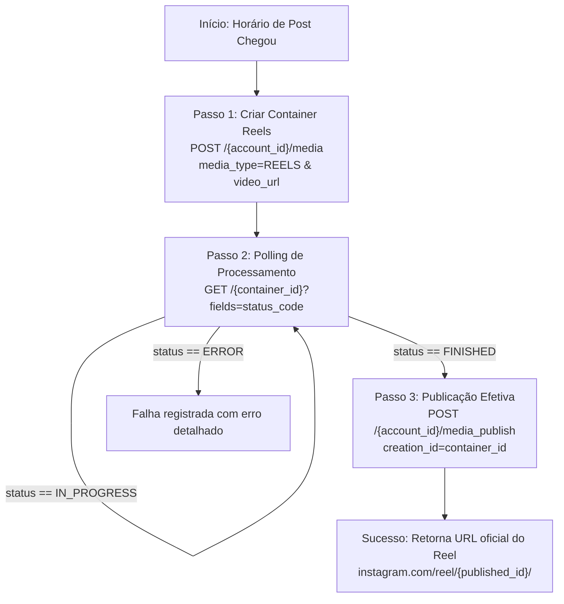

# 📸 Guia Passo a Passo: Integração da API Oficial do Instagram (Reels & Feed)

Este guia documenta todo o processo para configurar o **Meta for Developers (Facebook Developers)**, vincular a sua conta profissional do Instagram e extrair as credenciais necessárias (`INSTAGRAM_ACCESS_TOKEN` e `INSTAGRAM_ACCOUNT_ID`) para colocar no arquivo `.env` do **Social Stream Hub**.

---

## 🎯 Objetivo
Configurar a **Instagram Graph API** oficial para permitir que o sistema faça publicações automáticas e agendadas de vídeos diretamente no seu Instagram (Reels) sem intervenção manual e com total segurança (sem risco de bloqueios por ferramentas não-oficiais).

---

## 📋 Credenciais Necessárias no `backend/.env`

No arquivo `backend/.env`, você precisa preencher:

```env
# INSTAGRAM (META GRAPH API - REELS)
INSTAGRAM_ACCESS_TOKEN=seu_page_access_token_de_longa_duracao
INSTAGRAM_ACCOUNT_ID=seu_instagram_business_account_id
```

---

## ⚠️ Requisitos Obrigatórios Antes de Começar

Antes de ir para a plataforma de desenvolvedores da Meta, sua conta do Instagram precisa cumprir 3 condições:

1. **Conta Profissional:** Sua conta do Instagram **não pode ser pessoal**. Deve ser **Comercial (Business)** ou de **Criador de Conteúdo (Creator)**.
   - *Como mudar:* No app do Instagram > Configurações e privacidade > Tipo e ferramentas da conta > Mudar para conta profissional.
2. **Página do Facebook:** Você precisa de uma Página no Facebook (pode ser uma página em branco criada só para isso).
3. **Instagram Vinculado à Página do Facebook:**
   - Acesse sua Página no Facebook > Configurações > **Contas Vinculadas** > **Instagram**.
   - Conecte a sua conta do Instagram e confirme o acesso.

---

## 🚀 Passo a Passo Completo

### Passo 1: Criar uma Conta no Meta for Developers
1. Acesse o portal oficial [Meta for Developers](https://developers.facebook.com/).
2. Faça login com o seu perfil do Facebook (o mesmo perfil que administra a Página e o Instagram).
3. Se for sua primeira vez, clique em **"Começar"** (Get Started) e conclua o cadastro gratuito de desenvolvedor.

---

### Passo 2: Criar o Aplicativo Meta
1. No canto superior direito, clique em **"Meus Aplicativos"** (My Apps) > **"Criar aplicativo"** (Create App).
2. Na pergunta sobre o tipo ou caso de uso:
   - Selecione **"Outro"** (Other) e clique em Avançar.
   - Selecione o tipo **"Empresa"** (Business).
3. Preencha as informações:
   - **Nome de exibição:** `Publicador Social Hub` (ou o nome que desejar).
   - **E-mail de contato do app:** Seu e-mail.
   - **Conta empresarial (opcional):** Pode deixar em branco ou selecionar seu Business Manager se tiver.
4. Clique em **"Criar aplicativo"**.

---

### Passo 3: Adicionar a Instagram Graph API
1. No painel do seu aplicativo, role até encontrar **"Instagram Graph API"** (ou "Instagram").
2. Clique no botão **"Configurar"** (Set Up).

---

### Passo 4: Obter o Token e IDs com o Graph API Explorer
A Meta disponibiliza uma ferramenta para testar e gerar tokens de acesso de forma visual:

1. Acesse o [Graph API Explorer](https://developers.facebook.com/tools/explorer/).
2. No canto direito:
   - Em **"Aplicativo do Meta"**, selecione o aplicativo criado (`Publicador Social Hub`).
   - Em **"Token de acesso do usuário"**, clique em **"Adicionar uma permissão"** (Add a permission).
3. Adicione as seguintes permissões obrigatórias:
   - `instagram_basic`
   - `instagram_content_publish`
   - `pages_show_list`
   - `pages_read_engagement`
   - `pages_manage_posts`
4. Clique em **"Generate Access Token"** (Gerar token de acesso).
5. O Facebook abrirá uma janela popup pedindo para você autorizar o aplicativo. **Selecione a sua Página do Facebook e a conta do Instagram vinculada** e confirme todas as permissões.

---

### Passo 5: Descobrir o seu `INSTAGRAM_ACCOUNT_ID`
No Graph API Explorer, no campo da URL de requisição (onde está escrito `GET` e `v20.0/me?fields=...`):

1. Digite a seguinte consulta e clique em **Submit**:
   ```http
   GET me/accounts?fields=name,access_token,instagram_business_account
   ```
2. Na resposta JSON à direita, você verá algo parecido com:
   ```json
   {
     "data": [
       {
         "name": "Nome da Sua Página",
         "access_token": "EAABw...",
         "instagram_business_account": {
           "id": "17841400000000000"
         },
         "id": "100234567890123"
       }
     ]
   }
   ```
3. O número em `"instagram_business_account": { "id": "17841400000000000" }` é o seu **`INSTAGRAM_ACCOUNT_ID`**!
   - Copie esse ID numérico e guarde.
4. O valor `"access_token": "EAABw..."` dentro do bloco da sua página é o **Page Access Token**.

---

### Passo 6: Gerar um Token de Longa Duração (Nunca expira ou 60 dias)
O token gerado no Explorer dura apenas cerca de 1 a 2 horas. Para que as automações não parem, você precisa trocá-lo por um **Token de Longa Duração**:

1. Vá para a ferramenta [Access Token Debugger](https://developers.facebook.com/tools/debug/accesstoken/).
2. Cole o token gerado no Explorer e clique em **"Depurar"** (Debug).
3. Na parte inferior, clique no botão **"Estender token de acesso"** (Extend Access Token).
4. O sistema fornecerá um token válido por **60 dias**.
5. *(Opcional / Recomendado)*: Se você utilizar a requisição de Token de Página com o token estendido de usuário:
   ```http
   GET /{page-id}?fields=access_token&access_token={seu_token_estendido}
   ```
   O token retornado da Página **não terá data de expiração** (perpétuo), a menos que você troque a senha ou desconecte o app.
6. Copie esse token final e cole no `backend/.env` como **`INSTAGRAM_ACCESS_TOKEN`**.

---

## ⚡ Regra de Ouro do Instagram: URL do Vídeo Pública
A API do Instagram não aceita envio de bytes direto do seu computador em formulário multipart padrão. 
O fluxo oficial da Meta é:
1. O seu sistema envia uma **URL pública** onde o vídeo está hospedado (`https://.../meu_video.mp4`).
2. Os servidores da Meta baixam o vídeo dessa URL e processam o container de Reels.
3. Seu sistema confirma a publicação assim que o processamento terminar.

### Como testar localmente na sua máquina?
Se você estiver rodando o sistema no seu computador (`localhost`):
- O Instagram não consegue acessar `http://localhost:7800/uploads/...`.
- **Solução simples para testes locais:** Utilize uma ferramenta de túnel reverso gratuita como o **[Cloudflare Tunnel](https://developers.cloudflare.com/cloudflare-one/connections/connect-networks/)** ou o **[ngrok](https://ngrok.com/)**:
  ```bash
  ngrok http 7800
  ```
  Isso fornecerá uma URL pública (ex: `https://abc-123.ngrok-free.app`) que você pode apontar para a rota de download dos vídeos.
- **Em produção (VPS ou Nuvem):** Se o sistema estiver hospedado numa VPS com domínio/SSL ou os vídeos forem enviados para um bucket S3/Cloudflare R2/Supabase, a URL gerada já será 100% pública e direta.

---

## 🧪 Como o Social Stream Hub Realiza o Envio no Código

O nosso backend já está 100% implementado para esse fluxo no arquivo `backend/app/publishers/instagram.py`:



---

## 🛠️ Testando no Sistema

1. Abra o arquivo `backend/.env`.
2. Insira as credenciais:
   ```env
   SIMULATE_PUBLICATIONS=false
   INSTAGRAM_ACCESS_TOKEN=seu_token_aqui
   INSTAGRAM_ACCOUNT_ID=seu_account_id_aqui
   ```
3. Reinicie os contêineres ou o backend:
   ```bash
   docker restart social-publisher-api social-scheduler-worker
   ```
4. Pelo frontend ([http://localhost:7300](http://localhost:7300)), envie um vídeo marcando a rede **Instagram** e clique em **"Publicar Agora"** ou agende o horário!
